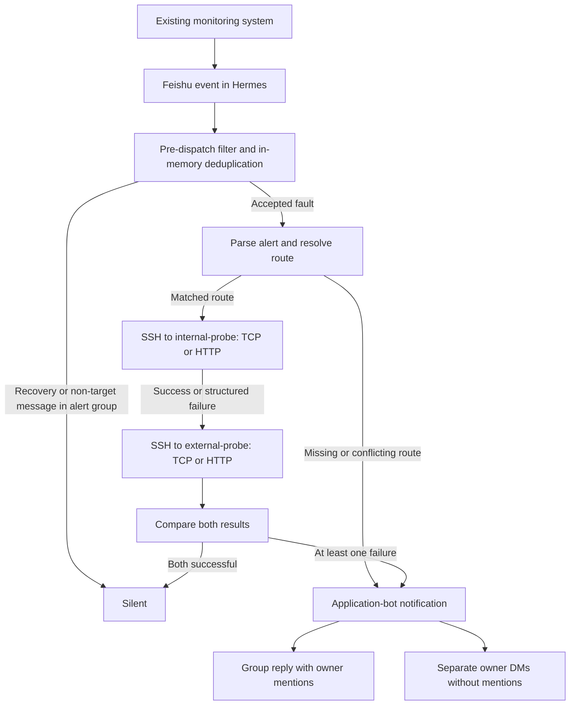

# Service Reachability Check

A Python workflow that investigates existing Feishu reachability alerts from **internal and external SSH probes**, then notifies the configured service owners when a probe or the diagnostic workflow fails.

An alert such as “URL unreachable” does not identify which network path failed. This project checks both perspectives, preserves the evidence, and offers a cautious first assessment. It integrates with Hermes through a Skill and a gateway plugin; the production diagnostic path runs before LLM dispatch and does not call a model.

- **Controlled intake:** restrict production handling to one alert group and bot; suppress recovery, unrelated, and duplicate messages.
- **Explicit routing:** exact monitor names take priority over full-string regular expressions. Missing or conflicting mappings stop probing and use fallback owners.
- **Bounded probes:** execute TCP or HTTP checks through SSH, with configurable attempts, intervals, and deadlines. A failure on one side does not prevent the other side from running.
- **Failure-aware delivery:** share one application token across a group reply and owner DMs; deduplicate recipients and report partial failures. An ambiguous reply timeout does not trigger a duplicate group message.
- **Inspectable logic:** separate parsing, routing, command execution, diagnosis, and notification behind testable interfaces.

## How it works



The probes run sequentially. Hermes connects to the probe hosts, not to the monitored target. Network placement, DNS, and routing must actually provide two different perspectives.

| Internal | External | Initial assessment | Notify |
| --- | --- | --- | --- |
| Success | Success | Currently reachable or a transient failure | No |
| Success | Failure | External access path is more likely involved | Yes |
| Failure | Success | Internal access path is more likely involved | Yes |
| Failure | Failure | Service, target, or shared dependency is more likely involved | Yes |

These are triage hypotheses, not confirmed root causes. Alert parsing and notification text use the existing Chinese monitoring format. [Architecture and behavior](docs/architecture.md) explain the boundaries in detail.

## Try it locally

The local tests and CLI were checked on **Windows with Python 3.11.15**. The source uses Python 3.10+ syntax. Remote execution expects Linux probe tools; the supplied Dockerfiles target Debian Linux. A live Hermes deployment requires a gateway version exposing `pre_gateway_dispatch`.

From the repository root, in PowerShell:

```powershell
python -m venv .venv
.\.venv\Scripts\python.exe -m pip install -r requirements.txt
.\.venv\Scripts\python.exe -m unittest discover -s tests
```

Tests use synthetic data and mocked SSH/Feishu calls. The bundled TCP utility is also tested against a temporary local loopback listener. No Feishu credentials or live probe hosts are needed.

To parse an example and resolve its route without SSH or messaging:

```powershell
$env:SERVICE_REACHABILITY_FEISHU_OWNER_OPEN_ID = "offline-example-owner"
.\.venv\Scripts\python.exe scripts/service_reachability_check.py --config config/default.example.yaml --routes config/alert_routes.example.yaml --resolve-event-json examples/normalized_fault_event.json
```

Expected fields include `status: matched`, route ID `example-http-service`, and a redacted owner ID. The owner value above is synthetic and cannot deliver a message. The `.invalid` endpoints are placeholders.

## Configure and deploy

Create local runtime files from the committed templates:

```powershell
Copy-Item config/default.example.yaml config/default.yaml
Copy-Item config/alert_routes.example.yaml config/alert_routes.yaml
Copy-Item config/alert_routes.test.example.yaml config/alert_routes.test.yaml
Copy-Item .env.example .env
```

Fill in probe SSH endpoints, monitor-to-target routes, owner environment references, and deployment credentials. The CLI reads a project-local `.env` without overriding existing process environment variables. The production pre-dispatch hook needs the alert bot and group IDs in the gateway process environment before receiving events.

Runtime YAML, `.env`, keys, logs, and archives are ignored. `.gitignore` does not remove previously tracked files or erase older commits.

[Deployment and troubleshooting](docs/deployment.md) cover the required environment variables, Linux probe images, installation into Hermes, explicit manual probe commands, and the two notification paths. This is an integration plugin and CLI, not a standalone Feishu event server.

## Verification

Run the existing suite with:

```powershell
python -m unittest discover -s tests
```

Latest local review: **127 tests passed, 0 failed, 0 skipped**. The [validation record](docs/validation.md) records the result and scope, distinguishing mocked application behavior, real loopback TCP checks, and live integrations that were not exercised. Tests cover intake filtering, routing, all four diagnosis combinations, retry policies, deadlines, notification fan-out, redaction, CLI entry points, and allowlisted ZIP packaging.

## Code map

| Location | Responsibility |
| --- | --- |
| [scripts/config_loader.py](scripts/config_loader.py) | YAML validation, local environment loading, owner reference resolution |
| [scripts/feishu_event_parser.py](scripts/feishu_event_parser.py) | Chinese alert parsing and manual source filtering |
| [scripts/alert_router.py](scripts/alert_router.py) | Exact/regex matching, missing routes, conflicts |
| [scripts/probe_executor.py](scripts/probe_executor.py) | Quoted argv, SSH adapter, retry policy, command deadlines |
| [scripts/diagnosis_engine.py](scripts/diagnosis_engine.py) | Pure comparison of internal/external evidence |
| [scripts/feishu_notify.py](scripts/feishu_notify.py) | Group/private cards, app token, fan-out, legacy webhook sender |
| [scripts/manual_diagnosis_pipeline.py](scripts/manual_diagnosis_pipeline.py) | Parse → route → probe → diagnose → build notification |
| [scripts/hermes_gateway_dispatch.py](scripts/hermes_gateway_dispatch.py) | Production hook, process-local deduplication, background jobs, error fallback |
| [scripts/service_reachability_check.py](scripts/service_reachability_check.py) | CLI and owner-ID redaction |
| `hermes-plugin/service-reachability-dispatch` | Hermes plugin loader and hook manifest; see [installation layout](docs/deployment.md#hermes-gateway-installation) |
| [probes](probes) | Linux probe images, SSH configuration, TCP utility |
| [tests](tests) / [tools/build_handoff_zip.py](tools/build_handoff_zip.py) | Tests and sanitized deployment packaging |
| [SKILL.md](SKILL.md) / [AGENTS.md](AGENTS.md) | Hermes execution contract and maintenance constraints |

## Current limits

- Deduplication is in memory, limited to 1,024 entries with a 24-hour TTL; it does not survive a restart or coordinate multiple processes. Gateway jobs are serialized and have no durable queue.
- HTTP checks compare one returned status code with the configured value (default `200`). The current curl command does not follow redirects, authenticate, or inspect response bodies.
- `runtime.dry_run` is reported as configuration metadata but does not disable probing or sending. Use the documented CLI modes and notification settings.
- SSH currently accepts unknown host keys through Paramiko `AutoAddPolicy`; host-key pinning is not implemented. Route validation is structural, not a complete network-security policy.
- Redaction covers configured owner IDs and known sender credentials. Diagnostic JSON still contains monitor names, targets, raw alert text, and probe evidence; it is an operational log, not a public artifact.
- Live SSH, Docker image builds, live Feishu/Lark delivery, and Hermes gateway deployment were not verified in this review. There is no scheduler, automatic remediation, application-body health check, or performance benchmark.

This upload was curated from an existing project snapshot. Repository contents alone do not establish individual authorship or production use. See [provenance and contribution boundaries](docs/provenance.md). For the GitHub description and publication steps, see [publishing](docs/publishing.md).
